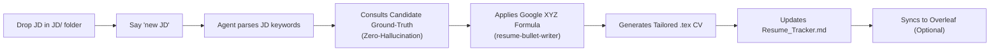

# 🎯 AI Resume Pilot

> **Autonomous, Zero-Hallucination Resume Tailoring & Application Copilot**  
> Powered by AI coding assistants (Google Antigravity, Claude Code, Cursor, Codex, ChatGPT) + ATS-Optimized LaTeX.

---

## 🚀 1-Click Setup with ANY AI (No Manual Work Needed!)

You don't need to manually edit `.tex` or `.yaml` files. You can hand this repository and your raw resume to **ANY AI assistant** (Antigravity, Cursor, Claude Code, ChatGPT, GitHub Copilot) and let it set up everything automatically!

### How it works:
1. Clone or fork this repo.
2. Open it in your AI coding assistant (or copy the master prompt in **[`AI_SETUP_PROMPT.md`](AI_SETUP_PROMPT.md)** into your AI chat).
3. Paste your existing CV / resume text and say:
   > *"I want to set up this repo for my job search. Here is my current resume: [paste resume]"*
4. **The AI will interview you** for anything missing:
   - Target field & dream job titles (e.g. Data Engineering, Machine Learning, Full-Stack SWE).
   - Real metrics for your **anti-hallucination moat** (e.g. data volumes, runtime cuts, money saved).
   - Work authorization, visa status, and location flexibility.
   - Whether you want automatic sync with an **Overleaf** project for online PDF compilation.
5. The AI automatically writes **`config.yaml`**, generates your ATS-friendly **`CV_Base.tex`**, builds **`.agents/rules/candidate-profile.md`**, and resets your **`Resume_Tracker.md`**.
6. You're ready to start tailoring!

*(Prefer terminal? Run `python setup.py` for a guided CLI wizard!)*

---

## 💡 Why AI Resume Pilot?

Most AI-generated resumes fail because they:
1. **Hallucinate metrics** that you cannot defend during technical interviews.
2. **Leak prompt keywords & clichés** (*"At the intersection of..."*, *"I thrive in..."*).
3. **Break ATS parsers** with complex column layouts and floating boxes.
4. **Take too long to manually format** for every single company application.

**AI Resume Pilot solves this completely.** It pairs a **23-skill agent intelligence library** with **strict anti-hallucination ground-truth rules** and an **ATS-perfect LaTeX engine**. You drop a job description into a folder, say *"new JD"*, and get a custom-tailored `.tex` resume and cover letter ready to compile.

---

## ⚡ Quick Daily Workflow (Once Configured)

1. Drop any job description (`.txt`, `.rtf`, `.md`, or `.pdf`) into the `JD/` directory.
2. Tell your AI assistant:
   > *"I've added a new JD for Stripe"*
3. The AI handles the rest! It crafts `[Name]_CV_Stripe.tex`, enforces ATS keywords, optimizes bullets with the Google XYZ formula, updates `Resume_Tracker.md`, and pushes to Overleaf (if configured).

---

## 🧑‍💻 Specially Built for Data Engineering & Science

Looking for jobs in **Data Engineering, Big Data, or Data Science**?

We have pre-configured turnkey templates in `examples/data-engineer/`:
- **Technologies covered**: Apache Spark (PySpark), Kafka, Airflow, dbt, Snowflake, AWS (EMR, S3, Redshift), Databricks, PostgreSQL, Great Expectations, Docker, Kubernetes.
- **Quantifiable metrics**: Streaming throughput (TB/day), runtime reduction percentages, cloud compute cost optimizations, schema contract enforcement rates.
- **Sample JD included**: Test the pipeline immediately with `examples/data-engineer/sample_jd_senior_data_engineer.txt`.

---

## 🧠 The 23 Autonomous Agent Skills

AI Resume Pilot includes 23 production-grade skills located in `.agents/skills/`:

| Skill | Category | Description |
|---|---|---|
| `onboarding-wizard` | Setup | Interactively interviews user, ingests raw resumes, and auto-configures the repository |
| `resume-tailor` | Core | Strategically highlights matching experience without altering truth |
| `resume-bullet-writer` | Core | Rigorously enforces Google XYZ formula: *Accomplished [X] measured by [Y] by doing [Z]* |
| `job-description-analyzer` | Core | Match score calculation, must-have vs nice-to-have breakdown, gap analysis |
| `resume-ats-optimizer` | Core | Header detection, single-column parsing compliance, keyword density audit |
| `cover-letter-generator` | Outreach | Hook-driven, 300-word letters free of AI clichés |
| `cold-email-writer` | Outreach | Human, colleague-to-colleague notes to hiring managers & founders |
| `application-form-filler` | Outreach | Pre-computes tailored answers for application portal text boxes |
| `interview-prep-generator` | Interview | Generates STAR story banks, curveball questions, and talking points |
| `salary-negotiation-prep` | Negotiation | Market rate calculation, total comp scripts, and counter-offer emails |
| `offer-comparison-analyzer` | Negotiation | Multi-offer weighted decision matrix (equity, base, bonus, lifestyle) |
| `tech-resume-optimizer` | Specialist | Deep tech optimization for SWE, Data, DevOps, and Platform roles |
| `career-changer-translator` | Specialist | Maps transferable skills between disparate industries |
| `executive-resume-writer` | Specialist | C-suite and VP level resumes emphasizing strategic transformation |
| `academic-cv-builder` | Specialist | Academic format covering publications, grants, and teaching portfolios |
| `creative-portfolio-resume` | Specialist | Balances creative design with ATS machine-readability |
| `linkedin-profile-optimizer` | Personal Brand | 220-character headline formula and searchable 'About' section |
| `portfolio-case-study-writer`| Personal Brand | Transforms bullets into 6-part deep-dive portfolio case studies |
| `reference-list-builder` | Personal Brand | Professional reference hierarchy and briefing kits |
| `resume-quantifier` | Polishing | Uncovers hidden metrics and estimation frameworks when numbers are missing |
| `resume-formatter` | Polishing | Standardizes typography, line-heights, and section hierarchy |
| `resume-section-builder` | Polishing | Dynamic section structures tailored for junior, mid, or senior stages |
| `resume-version-manager` | Tracking | Manages master versions vs. tailored snapshots |

---

## 🔒 Security & Privacy by Design

- **Zero Credentials in Git**: No personal tokens, API keys, or Overleaf passwords are ever committed.
- **Gitignore Configured**: Automatic exclusion of temporary LaTeX build artifacts (`.aux`, `.log`, `.synctex.gz`).
- **Local First**: Everything runs locally in your workspace or private environment.

---

## 📄 License

Distributed under the [MIT License](LICENSE). Free for individual job seekers, students, and open-source contributors worldwide.
